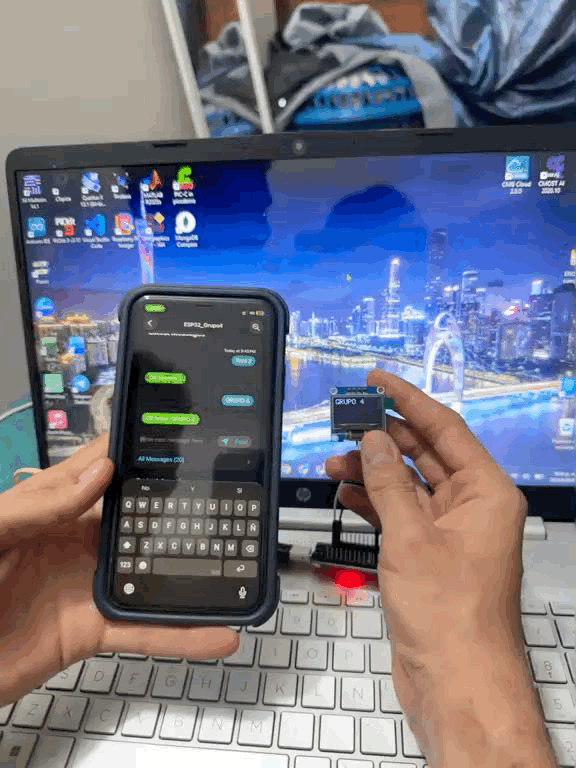
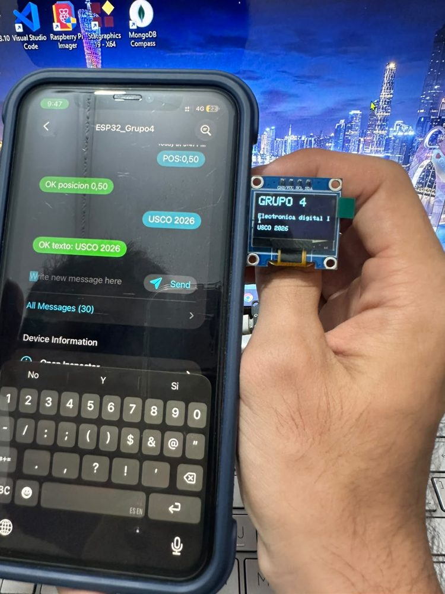
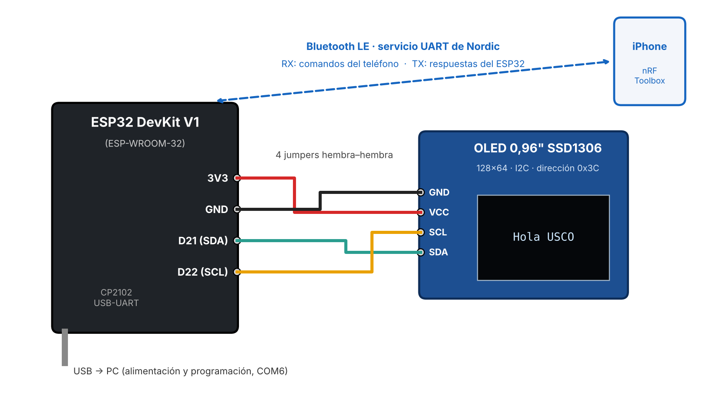

# ESP32 + BLE + OLED: pantalla controlada desde el celular

Sistema que recibe comandos de texto desde un teléfono (iPhone o Android) por **Bluetooth Low Energy** y los ejecuta en una pantalla **OLED SSD1306 128×64** conectada por **I2C** a un **ESP32**. Puede escribir texto libre, borrar la pantalla y cambiar el tamaño y la posición de la letra. Cada comando recibe confirmación en el teléfono.

<p align="center">
  
  
</p>

> Proyecto de laboratorio de **Electrónica Digital II**, Universidad Surcolombiana (Neiva, Colombia), octubre de 2026.

## ¿Por qué BLE y no Bluetooth clásico?

La mayoría de tutoriales de ESP32 usan Bluetooth clásico con el perfil serial **SPP** (`BluetoothSerial`). iOS no deja que las apps usen SPP: solo lo permite a accesorios certificados por Apple (programa MFi). Por eso implementé el **servicio UART de Nordic (NUS)** sobre BLE:

| Característica | UUID | Dirección |
|---|---|---|
| Servicio | `6E400001-B5A3-F393-E0A9-E50E24DCCA9E` | — |
| RX | `6E400002-…` | teléfono → ESP32 (WRITE) |
| TX | `6E400003-…` | ESP32 → teléfono (NOTIFY) |

Como interfaz se usa la app gratuita **nRF Toolbox** (Nordic Semiconductor), que reconoce el servicio UART. Así no hubo que programar una app propia.

## Hardware

| Componente | Detalle |
|---|---|
| ESP32 DevKit V1 | ESP-WROOM-32, conversor USB-UART CP2102 |
| OLED 0,96" | SSD1306, 128×64, I2C, dirección `0x3C` |
| 4 jumpers hembra–hembra | sin protoboard |



| OLED | ESP32 |
|---|---|
| VCC | 3V3 |
| GND | GND |
| SDA | GPIO21 |
| SCL | GPIO22 |

## Comandos

| Comando | Ejemplo | Acción | Respuesta |
|---|---|---|---|
| texto libre | `Hola USCO` | escribe y baja una línea | `OK texto: Hola USCO` |
| `TXT:` + mensaje | `TXT:Aviso` | igual que el texto libre | `OK texto: Aviso` |
| `BORRAR` | `BORRAR` | limpia la pantalla, cursor a (0,0) | `OK pantalla borrada` |
| `POS:x,y` | `POS:0,32` | mueve el cursor (x 0–127, y 0–63) | `OK posicion 0,32` |
| `TAM:n` | `TAM:2` | tamaño de letra 1, 2 o 3 | `OK tamano 2` |
| `AYUDA` | `AYUDA` | — | lista de comandos |
| inválido | `TAM:9` | no cambia nada | `ERROR: usa TAM:1, TAM:2 o TAM:3` |

Los comandos no distinguen mayúsculas de minúsculas.

## Cómo funciona el código

```
iPhone ──BLE──▶ RX ──▶ onWrite(): guarda el comando y levanta una bandera
                         │
                 loop(): ve la bandera ──▶ procesar(): identifica el comando
                                              │
                                   OLED (I2C) + responder() ──▶ TX (notify) ──▶ iPhone
```

- El evento `onWrite` **no toca la pantalla**: corre en la tarea del Bluetooth, y usar el I2C ahí puede bloquear la comunicación. Solo guarda el comando, y el `loop()` lo procesa.
- `procesar()` compara el comando con cada palabra clave, valida los parámetros (`constrain` para la posición, rango 1–3 para el tamaño) y responde por TX.
- Si la OLED no responde al iniciar, el programa avisa por el Monitor Serie y **el Bluetooth sigue funcionando**.
- Al desconectarse el teléfono, el ESP32 vuelve a anunciarse para aceptar otra conexión.

## Cómo usarlo

1. Instala **Arduino IDE** y en el Gestor de placas el paquete **esp32 de Espressif** (probado con la 3.3.12).
2. Instala las librerías **Adafruit SSD1306** y **Adafruit GFX** desde el Gestor de librerías.
3. En Windows, si la placa aparece con advertencia, instala el driver **[CP210x](https://www.silabs.com/developer-tools/usb-to-uart-bridge-vcp-drivers)**. Usa un cable USB de datos, no solo de carga.
4. Abre `firmware/ESP32_OLED_BLE/ESP32_OLED_BLE.ino`, elige **ESP32 Dev Module** y el puerto COM, y súbelo. Si se queda en `Connecting...`, mantén presionado **BOOT**.
5. En el teléfono: **nRF Toolbox** → *Connect to Device* → **ESP32_Grupo4** → escribe los comandos.

## Resultados

Todas las pruebas pasaron, incluida la validación de comandos inválidos. Detalle observado: con `TAM:1` cada carácter ocupa 6×8 px, así que caben unos 21 caracteres por línea (128 ÷ 6). Un texto de 22 caracteres parte su última letra a la línea siguiente.

El informe completo (CDIO: concebir, diseñar, implementar y operar) está en [`docs/Informe_Lab_ESP32_Grupo4.pdf`](docs/Informe_Lab_ESP32_Grupo4.pdf).

## Mejoras posibles

- Desplazamiento (scroll) del texto en lugar de sobrescribir al llegar abajo.
- Guardar el último mensaje en memoria flash para mostrarlo al reiniciar.
- Soporte para tildes y ñ con una fuente personalizada.
- App propia con botones fijos, o un tablero de avisos IoT por Wi-Fi.

## Créditos

- **Sebastián Serrato Ramírez**: diseño, firmware y documentación.
- **David Santiago Mondragón** y **Ximena del Rocío Moreno**: equipo de laboratorio (Grupo 4).
- Docente: Ing. Johan Julián Molina Mosquera.

Librerías: [Adafruit SSD1306](https://github.com/adafruit/Adafruit_SSD1306), [Adafruit GFX](https://github.com/adafruit/Adafruit-GFX-Library) y BLE del [Arduino-ESP32 de Espressif](https://github.com/espressif/arduino-esp32).

## Licencia

MIT. Ver [LICENSE](LICENSE).
